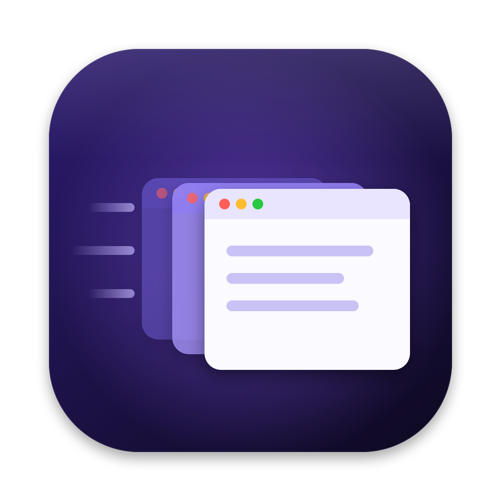
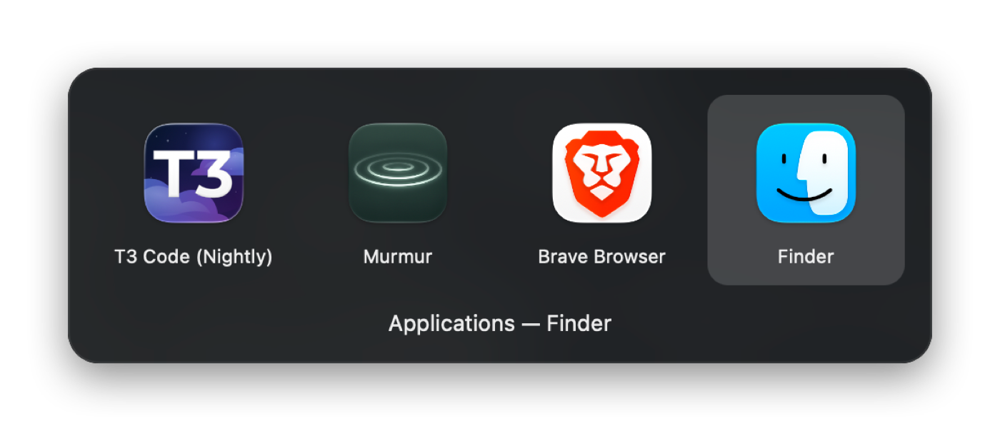

<p align="center">
  
</p>

<h1 align="center">Flick</h1>

<p align="center">
  <b>A lean ⌥Tab window switcher for macOS.</b><br>
  Every window, not just every app. Under 20 MB of memory. No screen recording.
</p>

<p align="center">
  
  
  <a href="LICENSE"></a>
</p>

<p align="center">
  
</p>

---

macOS's ⌘Tab switches between **apps**. If you have three browser windows open, you can't pick one of them from it. Flick adds a Windows-style ⌥Tab that switches between **windows**, and stays out of the way the rest of the time.

## Why another switcher?

[AltTab](https://github.com/lwouis/alt-tab-macos) is excellent and has many more features. Flick goes the other way and does one thing with as little as possible:

- **Small.** 15–18 MB while idle and about 21 MB with the panel open, measured with `footprint` on macOS 27. The panel's views are built when it opens and thrown away when it closes, so memory returns to idle afterwards (checked over 30 open/close cycles).
- **No window previews.** Live thumbnails are what make switchers heavy, and they need Screen Recording permission. Flick shows each window's app icon and title instead.
- **Fast.** All apps are asked for their windows in parallel, so listing takes about 30 ms. A quick ⌥Tab tap switches without the panel ever appearing.
- **Native.** Plain AppKit, written in Rust with [`objc2`](https://github.com/madsmtm/objc2). No SwiftUI, no web view, no runtime to load.
- **Private.** Flick needs only the Accessibility permission. It makes no network connections and collects nothing.

## Using it

| Keys | What happens |
|---|---|
| Hold **⌥**, press **Tab** | Open the switcher and move to the next window |
| **⌥⇧Tab** | Move backwards |
| **← → ↑ ↓** | Move the selection |
| Release **⌥**, or press **Return** | Switch to the selected window |
| **Esc**, or click outside the panel | Cancel |
| Click a window | Switch to it straight away |

Windows are listed with the one you used most recently first, so a quick ⌥Tab always takes you back to the window you were just in, even when it's another window of the same app. Minimized windows and windows of hidden apps are included and are restored when you pick them.

A small **⌥⇥** item in the menu bar lets you quit Flick.

## Install

There's no prebuilt download yet, so you build it from source. You need macOS 14 or later, [Rust](https://rustup.rs), and the Xcode Command Line Tools (`xcode-select --install`).

```sh
git clone https://github.com/georgenijo/flick.git
cd flick
./build.sh
open Flick.app
```

The first time it runs, Flick asks for **Accessibility** permission. Turn it on under **System Settings → Privacy & Security → Accessibility**. Flick starts working within a second, with no restart needed.

To keep it around, move `Flick.app` to `/Applications` and add it under **System Settings → General → Login Items**.

> **Tip:** `./build.sh` signs the app ad hoc, so macOS forgets the Accessibility permission each time you rebuild. If you have an Apple Development certificate, build with `SIGN_IDENTITY="Apple Development: Your Name (XXXXXXXXXX)" ./build.sh` and the permission is kept.

## How it works

| Part | How |
|---|---|
| Catching ⌥Tab | A `CGEventTap` sees key and mouse events. It swallows ⌥Tab and, only while the panel is open, the keys and clicks meant for Flick. Everything else passes through untouched. |
| Listing windows | The Accessibility API, queried for every app in parallel with a 250 ms timeout, so one frozen app can't stall the switcher. |
| Ordering | Flick keeps its own most-recently-used list. macOS raises every window of an app when it activates, so on-screen order alone can't tell which window you were in. |
| Switching | The window server's front-process call, the same approach AltTab uses, with a fallback to the standard Accessibility raise. |
| Drawing | A borderless `NSPanel` with a blurred background and plain `NSImageView`/`NSTextField` tiles. |

Flick calls three undocumented macOS functions: `_AXUIElementGetWindow`, `_SLPSSetFrontProcessWithOptions` and `SLPSPostEventRecordTo`. Every serious window switcher relies on them. The last two are loaded at runtime, so if a future macOS removes them Flick falls back to the public APIs instead of crashing.

## Not yet

- Windows on other Spaces (desktops) aren't listed.
- No settings: the shortcut is fixed to ⌥Tab.
- No prebuilt, notarized download.

Issues and pull requests are welcome.

## Development

```sh
cargo build --release          # just the binary
./build.sh                     # Flick.app
target/release/flick --list    # print the windows Flick would show, with timing
```

Run it with logging:

```sh
open --env FLICK_DEBUG=1 --stderr /tmp/flick.log Flick.app
```

`tests/` has end-to-end checks that post real key and mouse events to a running Flick. Your terminal needs Accessibility permission for them, and they will switch your windows around while they run.

```sh
swiftc -O tests/e2e.swift -o tests/bin/e2e
tests/bin/e2e "$(pgrep -x flick)" /tmp/panel.png "$(pgrep -x Finder)"   # ⌥Tab, quick ⌥Tab back, Esc, 30-cycle leak check

swiftc -O tests/click.swift -o tests/bin/click
tests/bin/click 1 "$(pgrep -x Finder)"         # hold ⌥ and click tile 2
tests/bin/click outside "$(pgrep -x Finder)"   # click outside the panel to cancel
```

The icon is drawn in code. Run `swift assets/make-icon.swift` to regenerate `assets/icon.png` and `assets/Flick.icns`.

## License

[MIT](LICENSE)
